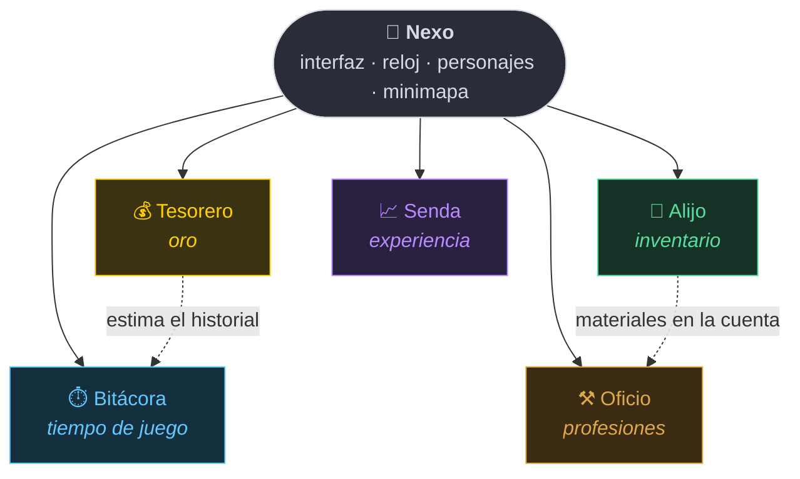

<div align="center">


<br>


**Seis addons propios para World of Warcraft** (cliente Classic, interfaz `16001`), con la interfaz en español.<br>
Cinco de ellos registran algo distinto de tu cuenta y el sexto, **Nexo**, es el núcleo que comparten.

[Addons](#-los-addons) •
[Instalación](#-instalación) •
[Comandos](#%EF%B8%8F-comandos) •
[Conviene saber](#-cosas-que-conviene-saber) •
[Datos](#-datos-guardados) •
[Estructura](#-estructura) •
[Estado](#-estado)

</div>

---

## 🧩 Los addons

| | Addon | Qué hace | Comando | Versión |
|:-:|---|---|:-:|:-:|
| 🔗 | **Nexo** | Núcleo común: piezas de interfaz, reloj de juego, registro de personajes y un único botón de minimapa. | `/nexo` | `1.0.0` |
| 💰 | **Tesorero** | Historial de oro: cuánto ganas, cuánto gastas y en qué (botín, misiones, mercader, reparaciones, subasta...). | `/tesoro` | `1.1.0` |
| ⏱️ | **Bitácora** | Tiempo de juego: por día, por personaje, por zona y por sesión, con el tiempo ausente aparte. | `/bita` | `1.2.0` |
| 🎒 | **Alijo** | Inventario de toda la cuenta: busca un objeto y mira qué personaje lo tiene, en bolsas, banco o equipado. | `/alijo` | `1.1.0` |
| 📈 | **Senda** | Subida de nivel: experiencia por hora, tiempo para subir, tiempo en cada nivel y origen de la experiencia. | `/senda` | `1.1.0` |
| ⚒️ | **Oficio** | Profesiones: nivel de cada una, qué recetas conoce cada personaje y enfriamientos de fabricación. | `/oficio` | `0.1.0` |



<sub>Línea continua: depende de Nexo. Línea discontinua: aprovecha los datos del otro addon si está instalado.</sub>

---

## 📦 Instalación

1. **Copia** las seis carpetas a `World of Warcraft\<versión>\Interface\AddOns`:

   ```
   Interface\AddOns\
   ├── Nexo\
   ├── Tesorero\
   ├── Bitacora\
   ├── Alijo\
   ├── Senda\
   └── Oficio\
   ```

2. **Reinicia el juego por completo.**
3. En la lista de addons, Tesorero, Bitácora, Alijo, Senda y Oficio aparecen **agrupados debajo de Nexo**.

> [!WARNING]
> Con `/reload` no basta cuando se añade un addon nuevo o cambia un `.toc`: hay que cerrar y volver a abrir el juego.

> [!IMPORTANT]
> **Nexo tiene que estar activado**: los otros cinco dependen de él y no cargan sin él. No hace falta instalar los cinco; cada uno funciona con solo Nexo.

---

## ⌨️ Comandos

Tesorero, Bitácora, Alijo, Senda y Oficio **abren o cierran su ventana** si su comando se escribe sin nada más, y los cinco aceptan `ayuda` y `minimapa`.

<details open>
<summary><b>🔗 Nexo</b> — <code>/nexo</code></summary>

| Comando | Qué hace |
|---|---|
| `/nexo` | Lista los addons conectados. |
| `/nexo minimapa` | Muestra u oculta el botón del minimapa, que es compartido. Al pulsarlo sale un menú con los addons instalados. |

</details>

<details>
<summary><b>💰 Tesorero</b> — <code>/tesoro</code> o <code>/tesorero</code></summary>

| Comando | Qué hace |
|---|---|
| `/tesoro reset` | Borra el historial del personaje actual (pide confirmación). |

</details>

<details>
<summary><b>⏱️ Bitácora</b> — <code>/bita</code> o <code>/bitacora</code></summary>

| Comando | Qué hace |
|---|---|
| `/bita importar` | Estima el historial anterior a la instalación a partir de los movimientos de oro de Tesorero. |
| `/bita quitar estimadas` | Borra lo estimado y deja solo lo medido. |
| `/bita reset` | Borra el registro del personaje actual (pide confirmación). |

</details>

<details>
<summary><b>🎒 Alijo</b> — <code>/alijo</code></summary>

| Comando | Qué hace |
|---|---|
| `/alijo <texto>` | Abre la ventana buscando ese texto en toda la cuenta. |
| `/alijo tooltip` | Activa o desactiva el recuento en el tooltip de los objetos. Viene desactivado si está Bagnon, que ya lo muestra. |
| `/alijo olvidar <personaje>` | Borra lo registrado de un personaje. |

</details>

<details>
<summary><b>📈 Senda</b> — <code>/senda</code></summary>

| Comando | Qué hace |
|---|---|
| `/senda avisos` | Activa o desactiva el resumen en el chat al subir de nivel. |
| `/senda reset` | Borra el registro del personaje actual (pide confirmación). |

</details>

<details>
<summary><b>⚒️ Oficio</b> — <code>/oficio</code></summary>

| Comando | Qué hace |
|---|---|
| `/oficio <texto>` | Abre la ventana buscando ese texto en las recetas y en sus materiales. |
| `/oficio avisos` | Activa o desactiva el aviso en el chat, al entrar, de los enfriamientos que ya están listos. |
| `/oficio olvidar <personaje>` | Borra lo registrado de un personaje. |
| `/oficio reset` | Borra lo registrado del personaje actual (pide confirmación). |

</details>

---

## 💡 Cosas que conviene saber

| | Qué pasa | Por qué |
|:-:|---|---|
| 👤 | **Cada personaje aparece cuando entras con él.** | Ningún addon puede leer datos de un personaje desconectado. |
| 🏦 | **El banco solo se registra al abrirlo.** | Alijo necesita que visites el banco una vez con cada personaje. |
| 📜 | **Las recetas solo se registran al abrir la ventana de la profesión.** | Oficio necesita que abras cada profesión una vez con cada personaje, y otra vez cuando aprendas recetas nuevas. Los niveles se leen solos al entrar. |
| ⏳ | **Los enfriamientos se calculan desde la última vez que abriste la profesión.** | Si fabricas algo con enfriamiento, Oficio lo sabe porque la ventana está abierta en ese momento. |
| 🔀 | **Los materiales de una receta se cruzan con Alijo.** | Si Alijo está activado, Oficio muestra cuántas unidades de cada material hay en la cuenta (bolsas y banco). |
| 🗓️ | **El historial empieza al instalar.** | El juego no guarda el pasado. La única excepción es Bitácora, que puede estimarlo a partir de Tesorero y lo marca como estimado. |
| 🔍 | **El origen de la experiencia y del oro es deducido.** | El juego solo avisa de que la cantidad ha cambiado; Senda y Tesorero lo relacionan con lo que ocurre en ese instante (una muerte, una misión entregada, un mercader abierto). Lo que no se identifica cae en "Otros". |

---

## 💾 Datos guardados

Cada addon guarda lo suyo en `WTF\Account\<cuenta>\SavedVariables`, en un archivo por addon:

| Addon | Variable guardada |
|---|---|
| 🔗 Nexo | `NexoDB` |
| 💰 Tesorero | `TesoreroDB` |
| ⏱️ Bitácora | `BitacoraDB` |
| 🎒 Alijo | `AlijoDB` |
| 📈 Senda | `SendaDB` |
| ⚒️ Oficio | `OficioDB` |

> [!TIP]
> Actualizar los addons no toca esos archivos. Para hacer una copia de seguridad, cópialos **con el juego cerrado**, porque al salir los sobrescribe.

---

## 🏗️ Estructura

Cada addon tiene tres archivos:

```
<Addon>\
├── <Addon>.toc   → metadatos, dependencias y orden de carga
├── Core.lua      → datos, eventos del juego y comandos
└── UI.lua        → ventana y elementos visuales
```

### Qué ofrece Nexo

Los demás addons lo usan a través de la tabla global `Nexo`:

| Función | Para qué sirve |
|---|---|
| `Nexo.Kit(tema)` | Devuelve las piezas de interfaz con los colores del addon: `Window`, `Panel`, `Button`, `Card`, `CharButton`, `SectionTitle`, `Text` y `Tex`. |
| `Nexo.Register(def)` | Apunta el addon en el menú del botón del minimapa. |
| `Nexo.OnTick(fn)` | Llama a `fn(dt, ahora)` cada 5 segundos de juego, sin contar el tiempo con el equipo suspendido. |
| `Nexo.OnPlayed(fn)` | Llama a `fn(total, enEsteNivel)` con el `/played` real, pedido sin ensuciar el chat. |
| `Nexo.CharKey()`, `Nexo.Char()`, `Nexo.CharList()` | Registro de personajes de la cuenta. |
| `Nexo.Dur`, `Nexo.Num`, `Nexo.DayKey`, `Nexo.DayLabel` | Formato de duraciones, números y fechas. |

### Añadir un addon nuevo sobre Nexo

En su `.toc` hacen falta estas dos líneas para que dependa de Nexo y aparezca agrupado debajo de él:

```toc
## Dependencies: Nexo
## Group: Nexo
```

---

## 🚦 Estado

| Addon | Estado |
|---|---|
| 🔗 Nexo · 💰 Tesorero · ⏱️ Bitácora · 🎒 Alijo · 📈 Senda | ✅ Probados en el juego por su autor, en un único cliente. |
| ⚒️ Oficio `0.1.0` | 🟡 Visto funcionar con un solo personaje: registro de niveles y de recetas, detalle de materiales y cruce con Alijo. **Sin probar:** los enfriamientos y el uso con varios personajes. |

> [!NOTE]
> No hay pruebas automáticas.
