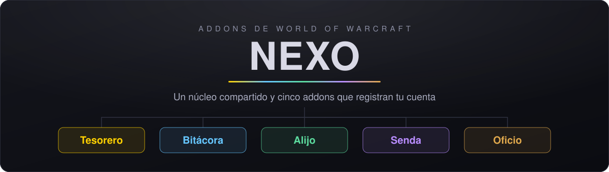
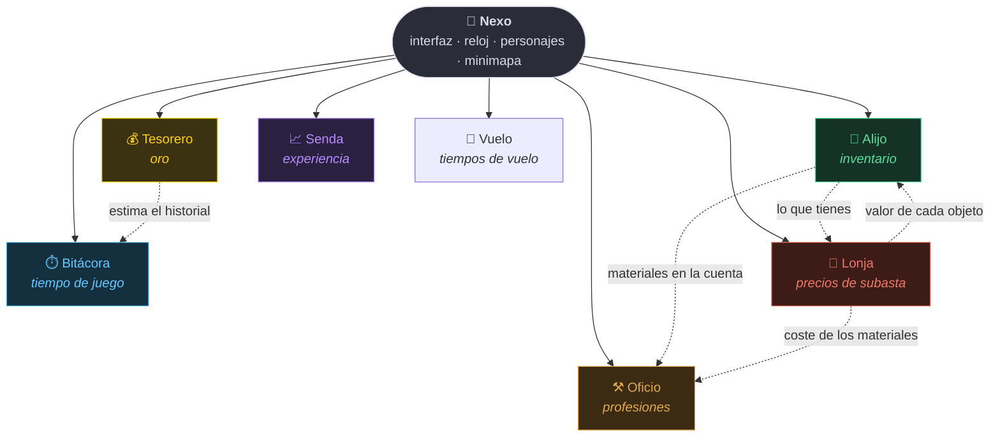

<div align="center">



<br>


**Siete addons propios para World of Warcraft** (cliente Classic, interfaz `16001`), con la interfaz en español.<br>
Seis de ellos registran algo distinto de tu cuenta y el séptimo, **Nexo**, es el núcleo que comparten.

[Addons](#-los-addons) •
[Instalación](#-instalación) •
[Comandos](#%EF%B8%8F-comandos) •
[Conviene saber](#-cosas-que-conviene-saber) •
[Datos](#-datos-guardados) •
[Estructura](#-estructura) •
[Publicar](#-publicar-una-versión) •
[Estado](#-estado)

</div>

---

## 🧩 Los addons

| | Addon | Qué hace | Comando | Versión |
|:-:|---|---|:-:|:-:|
| 🔗 | **Nexo** | Núcleo común: piezas de interfaz, reloj de juego, registro de personajes y un único botón de minimapa. | `/nexo` | `1.5.2` |
| 💰 | **Tesorero** | Historial de oro: cuánto ganas, cuánto gastas y en qué (botín, misiones, mercader, reparaciones, subasta...). | `/tesoro` | `1.1.0` |
| ⏱️ | **Bitácora** | Tiempo de juego: por día, por personaje, por zona y por sesión, con el tiempo ausente aparte. | `/bita` | `1.2.0` |
| 🎒 | **Alijo** | Inventario de toda la cuenta: busca un objeto y mira qué personaje lo tiene, en bolsas, banco o equipado. | `/alijo` | `1.2.0` |
| 📈 | **Senda** | Subida de nivel: experiencia por hora, tiempo para subir, tiempo en cada nivel y origen de la experiencia. | `/senda` | `1.1.0` |
| ⚒️ | **Oficio** | Profesiones: nivel de cada una, qué recetas conoce cada personaje y enfriamientos de fabricación. | `/oficio` | `0.2.0` |
| 🔨 | **Lonja** | Precios de subasta: guarda el precio mínimo de cada objeto al escanear y valora lo que tienes en la cuenta. | `/lonja` | `0.2.0` |
| 🦅 | **Vuelo** | Vuelos de los maestros de vuelo: cuánto tarda cada destino y una cuenta atrás en pantalla, que se puede mover, mientras vuelas. | `/vuelo` | `0.1.0` |



<sub>Línea continua: depende de Nexo. Línea discontinua: aprovecha los datos del otro addon si está instalado.</sub>

---

## 📦 Instalación

1. **Copia** las ocho carpetas a `World of Warcraft\<versión>\Interface\AddOns`:

   ```
   Interface\AddOns\
   ├── Nexo\
   ├── Nexo_Tesorero\
   ├── Nexo_Bitacora\
   ├── Nexo_Alijo\
   ├── Nexo_Senda\
   ├── Nexo_Oficio\
   ├── Nexo_Lonja\
   └── Nexo_Vuelo\
   ```

2. **Reinicia el juego por completo.**
3. En la lista de addons, Tesorero, Bitácora, Alijo, Senda, Oficio y Lonja aparecen **agrupados debajo de Nexo**.

> [!WARNING]
> Con `/reload` no basta cuando se añade un addon nuevo o cambia un `.toc`: hay que cerrar y volver a abrir el juego.

> [!IMPORTANT]
> **Nexo tiene que estar activado**: los otros seis dependen de él y no cargan sin él. No hace falta instalar los seis; cada uno funciona con solo Nexo.

### Actualizar desde una versión anterior a `Nexo_<nombre>`

Hasta Nexo `1.3.0` las carpetas se llamaban `Tesorero`, `Bitacora`, `Alijo`, `Senda`, `Oficio` y `Lonja`. El juego guarda los datos de cada addon con el nombre de su carpeta, así que el cambio de nombre se hace en dos pasos para no perder nada:

1. **Copia las carpetas nuevas sin borrar las antiguas** (sustituye `Nexo`) y entra al juego.
2. Nexo avisa de que ha encontrado los addons antiguos, los desactiva y pide **recargar la interfaz**. Esa primera vez siguen funcionando los antiguos; al recargar, los `Nexo_<nombre>` arrancan con los datos de siempre.
3. Ya puedes **borrar las carpetas antiguas** de `Interface\AddOns`.

> [!WARNING]
> Si borras las carpetas antiguas **antes** de entrar al juego, los addons aparecen vacíos. Los datos no se han perdido: siguen en `WTF\Account\<cuenta>\SavedVariables` con el nombre antiguo. Cierra el juego y haz doble clic en `Recuperar datos antiguos.bat`, de la carpeta [`herramientas`](herramientas).

---

## ⌨️ Comandos

Tesorero, Bitácora, Alijo, Senda, Oficio y Lonja **abren o cierran su ventana** si su comando se escribe sin nada más, y los seis aceptan `ayuda` y `minimapa`.

<details open>
<summary><b>🔗 Nexo</b> — <code>/nexo</code></summary>

| Comando | Qué hace |
|---|---|
| `/nexo` | Lista los addons conectados. |
| `/nexo ayuda` | Lista los comandos de Nexo. También vale `/nexo help`. |
| `/nexo minimapa` | Muestra u oculta el botón del minimapa, que es compartido. Al pulsarlo sale un menú con los addons instalados. |
| `/nexo datos` | Abre la ventana de exportar e importar los datos, para cambiar de ordenador. También está al final del menú del minimapa. `/nexo exportar` y `/nexo importar` la abren ya en ese modo. |

</details>

<details>
<summary><b>💰 Tesorero</b> — <code>/tesoro</code> o <code>/tesorero</code></summary>

| Comando | Qué hace |
|---|---|
| `/tesoro reset` | Borra el historial del personaje actual (pide confirmación). |

</details>

<details>
<summary><b>⏱️ Bitácora</b> — <code>/bita</code> o <code>/bitacora</code></summary>

| Comando | Qué hace |
|---|---|
| `/bita importar` | Estima el historial anterior a la instalación a partir de los movimientos de oro de Tesorero. |
| `/bita quitar estimadas` | Borra lo estimado y deja solo lo medido. |
| `/bita reset` | Borra el registro del personaje actual (pide confirmación). |

</details>

<details>
<summary><b>🎒 Alijo</b> — <code>/alijo</code></summary>

| Comando | Qué hace |
|---|---|
| `/alijo <texto>` | Abre la ventana buscando ese texto en toda la cuenta. |
| `/alijo tooltip` | Activa o desactiva el recuento en el tooltip de los objetos. Viene desactivado si está Bagnon, que ya lo muestra. |
| `/alijo olvidar <personaje>` | Borra lo registrado de un personaje. |

</details>

<details>
<summary><b>📈 Senda</b> — <code>/senda</code></summary>

| Comando | Qué hace |
|---|---|
| `/senda avisos` | Activa o desactiva el resumen en el chat al subir de nivel. |
| `/senda reset` | Borra el registro del personaje actual (pide confirmación). |

</details>

<details>
<summary><b>⚒️ Oficio</b> — <code>/oficio</code></summary>

| Comando | Qué hace |
|---|---|
| `/oficio <texto>` | Abre la ventana buscando ese texto en las recetas y en sus materiales. |
| `/oficio avisos` | Activa o desactiva el aviso en el chat, al entrar, de los enfriamientos que ya están listos. |
| `/oficio olvidar <personaje>` | Borra lo registrado de un personaje. |
| `/oficio reset` | Borra lo registrado del personaje actual (pide confirmación). |

</details>

<details>
<summary><b>🔨 Lonja</b> — <code>/lonja</code></summary>

| Comando | Qué hace |
|---|---|
| `/lonja <texto>` | Abre la ventana buscando ese texto en los precios guardados. |
| `/lonja escanear` | Escanea la casa de subastas, que tiene que estar abierta. También hay un botón en la ventana de Lonja y otro encima de la ventana de la subasta. |
| `/lonja parar` | Para el escaneo en marcha y guarda lo que dio tiempo a leer. |
| `/lonja auto` | Activa o desactiva el escaneo automático al abrir la subasta (viene activado). |
| `/lonja comprar` | Enseña la lista de compra. |
| `/lonja comprar <enlace> <precio> <cantidad>` | Apunta un objeto en la lista de compra: precio máximo por unidad (en oro, `1.5`, o con monedas, `1g 50s`) y unidades. También se hace desde la ventana, al pie del detalle del objeto. |
| `/lonja quitar <enlace>` | Quita un objeto de la lista de compra. |
| `/lonja tooltip` | Activa o desactiva el precio en el tooltip de los objetos. |
| `/lonja reset` | Borra los precios guardados del reino actual (pide confirmación). |
| `/lonja diag` | Muestra qué API de subasta tiene el cliente y los últimos escaneos, para diagnosticar fallos. |

</details>

<details>
<summary><b>🦅 Vuelo</b> — <code>/vuelo</code></summary>

Vuelo no tiene ventana: `/vuelo` enseña u oculta el contador de muestra para colocarlo arrastrándolo con el ratón.

| Comando | Qué hace |
|---|---|
| `/vuelo centro` | Devuelve el contador a su sitio de origen. |
| `/vuelo chat` | Activa o desactiva los avisos en el chat al despegar y al medir una ruta nueva. |

</details>

---

## 💡 Cosas que conviene saber

| | Qué pasa | Por qué |
|:-:|---|---|
| 👤 | **Cada personaje aparece cuando entras con él.** | Ningún addon puede leer datos de un personaje desconectado. |
| 🏦 | **El banco solo se registra al abrirlo.** | Alijo necesita que visites el banco una vez con cada personaje. |
| 📜 | **Las recetas solo se registran al abrir la ventana de la profesión.** | Oficio necesita que abras cada profesión una vez con cada personaje, y otra vez cuando aprendas recetas nuevas. Los niveles se leen solos al entrar. |
| 🦅 | **Los tiempos de vuelo se aprenden volando.** | El juego no dice cuánto dura un vuelo. Vuelo guarda lo que tarda cada ruta la primera vez que la haces; hasta entonces da un tiempo aproximado (marcado con `~` o «unos») calculado con lo que mide la ruta en el mapa y los vuelos ya medidos en ese continente, o cuenta hacia arriba si aún no tiene con qué calcularlo. |
| ⏳ | **Los enfriamientos se calculan desde la última vez que abriste la profesión.** | Si fabricas algo con enfriamiento, Oficio lo sabe porque la ventana está abierta en ese momento. |
| 🔀 | **Los materiales de una receta se cruzan con Alijo.** | Si Alijo está activado, Oficio muestra cuántas unidades de cada material hay en la cuenta (bolsas y banco). |
| 🔨 | **Los precios son de la última vez que escaneaste.** | Lonja solo puede leer la subasta con su ventana abierta. Guarda el precio de compra más bajo por unidad; las subastas que solo admiten puja no cuentan. Lo que ya no está a la venta conserva su último precio, con la fecha en que se vio. |
| ⚡ | **El escaneo rápido solo se puede usar cada 15 minutos.** | Es un límite del juego. Si no está disponible, Lonja escanea página a página, que tarda más. Las búsquedas que hagas a mano en la subasta también se apuntan. |
| 🔁 | **Lonja escanea sola al abrir la subasta.** | Solo si han pasado los 15 minutos del escaneo rápido; si no, avisa de cuánto falta y usa los precios que ya tenía. Se apaga con `/lonja auto`. |
| 🛒 | **La lista de compra pide un clic por compra.** | El juego no deja a ningún addon comprar por su cuenta. Lonja avisa de lo que está a tu precio y prepara la compra (objeto, unidades y coste, sin pasar de tu precio máximo ni de la cantidad que pediste); el botón de encima de la subasta la hace paso a paso: buscar, comprar y, en los materiales, confirmar el precio final. |
| ⚖️ | **Cada facción tiene sus precios.** | Lonja guarda los precios por reino y facción, y conserva 14 días de historial por objeto. |
| 💱 | **Los precios se cruzan con Alijo y Oficio.** | Con Lonja activado, Alijo muestra lo que vale cada objeto, Oficio lo que cuestan los materiales de una receta y por cuánto se vende lo fabricado, y Lonja lo que vale todo lo guardado en bolsas y bancos (lo equipado no cuenta). |
| 🗓️ | **El historial empieza al instalar.** | El juego no guarda el pasado. La única excepción es Bitácora, que puede estimarlo a partir de Tesorero y lo marca como estimado. |
| 🔍 | **El origen de la experiencia y del oro es deducido.** | El juego solo avisa de que la cantidad ha cambiado; Senda y Tesorero lo relacionan con lo que ocurre en ese instante (una muerte, una misión entregada, un mercader abierto). Lo que no se identifica cae en "Otros". |

---

## 💾 Datos guardados

Cada addon guarda lo suyo en `WTF\Account\<cuenta>\SavedVariables`, en un archivo por addon:

| Addon | Archivo | Variable guardada |
|---|---|---|
| 🔗 Nexo | `Nexo.lua` | `NexoDB` |
| 💰 Tesorero | `Nexo_Tesorero.lua` | `TesoreroDB` |
| ⏱️ Bitácora | `Nexo_Bitacora.lua` | `BitacoraDB` |
| 🎒 Alijo | `Nexo_Alijo.lua` | `AlijoDB` |
| 📈 Senda | `Nexo_Senda.lua` | `SendaDB` |
| ⚒️ Oficio | `Nexo_Oficio.lua` | `OficioDB` |
| 🔨 Lonja | `Nexo_Lonja.lua` | `LonjaDB` |
| 🦅 Vuelo | `Nexo_Vuelo.lua` | `VueloDB` |

> [!TIP]
> Actualizar los addons no toca esos archivos. Los de antes del cambio de nombre (`Tesorero.lua`, `Bitacora.lua`...) se quedan donde estaban, como copia de ese momento.

### Cambiar de ordenador (exportar e importar)

Un addon no puede leer ni escribir archivos, así que hay dos caminos: copiar y pegar un texto dentro del juego, o mover los archivos desde fuera.

#### Desde el juego

1. **En el ordenador viejo**, escribe `/nexo datos` (o elige *Exportar / importar* en el menú del minimapa), marca los addons que quieres llevarte y pulsa **Generar texto**. El texto queda seleccionado: cópialo con `Ctrl+C` y pégalo en un archivo de texto.
2. Lleva ese archivo al otro ordenador e instala allí los addons.
3. **En el ordenador nuevo**, escribe `/nexo importar`, pega el texto con `Ctrl+V` y pulsa **Importar y recargar** dos veces (la segunda confirma).

| | Qué pasa | Por qué |
|:-:|---|---|
| 🔁 | **Importar sustituye, no mezcla.** | Los datos de los addons marcados se cambian por los del texto y la interfaz se recarga. Los addons sin marcar no se tocan. |
| 🧩 | **Solo se importa lo que está instalado.** | Los datos de un addon que no está activado en el ordenador nuevo se ignoran. |
| ✂️ | **Un texto cortado o cambiado se rechaza.** | Lleva una suma de comprobación, así que no se importa nada a medias. |
| 📏 | **Lonja es casi todo el tamaño.** | Con todo son unos 300 KB de texto comprimido; sin Lonja, unas decenas. Si pegar tanto texto de una vez falla, lleva Lonja aparte o usa el camino de abajo. |

#### Desde fuera del juego

Con la carpeta [`herramientas`](herramientas), que copia los archivos tal cual y sirve también de copia de seguridad:

1. **En el ordenador viejo**, cierra el juego y haz doble clic en `Exportar datos.bat`. Deja en el Escritorio un `nexo-datos-<fecha>.zip` con los datos de los siete addons.
2. Lleva ese `.zip` al otro ordenador (y la carpeta `herramientas`), e instala allí los addons.
3. **En el ordenador nuevo**, con el juego cerrado, arrastra el `.zip` encima de `Importar datos.bat`. Si lo ejecutas sin arrastrar nada, usa el `.zip` más reciente del Escritorio o de Descargas.

| | Qué pasa | Por qué |
|:-:|---|---|
| 🔁 | **Importar sustituye, no mezcla.** | Lo que hubiera en el ordenador nuevo se cambia por lo del `.zip`. Antes pregunta, y deja al lado del `.zip` una copia de lo que había (`nexo-copia-antes-de-importar-<fecha>.zip`), que se puede volver a importar. |
| 🚪 | **Importar exige el juego cerrado.** | Al salir, el juego sobrescribe los datos con los que tiene en memoria. Exportar con el juego abierto funciona, pero lleva lo guardado en la última salida o `/reload`. |
| 📁 | **Si no encuentra el juego, hay que decirle dónde está.** | Busca en el registro y en las rutas habituales. Si no, desde PowerShell: `.\Datos.ps1 exportar -Juego "D:\World of Warcraft"`. |
| 💾 | **También sirve de copia de seguridad.** | El `.zip` de exportar es una copia completa de los datos en ese momento. |
| 🏷️ | **Valen los `.zip` y los textos de antes del cambio de nombre.** | Al importar un `.zip` con los archivos antiguos (`Tesorero.lua`...), se guardan con el nombre nuevo. Los textos de `/nexo exportar` no dependen del nombre de la carpeta. |

---

## 🏗️ Estructura

Cada addon tiene tres archivos. La carpeta y el `.toc` se llaman `Nexo_<nombre>` (el núcleo, solo `Nexo`); dentro del juego el addon sigue llamándose por su nombre (Tesorero, `/tesoro`, `TesoreroDB`):

```
Nexo_<nombre>\
├── Nexo_<nombre>.toc   → metadatos, dependencias y orden de carga
├── Core.lua      → datos, eventos del juego y comandos
└── UI.lua        → ventana y elementos visuales
```

### Qué ofrece Nexo

Los demás addons lo usan a través de la tabla global `Nexo`:

| Función | Para qué sirve |
|---|---|
| `Nexo.Kit(tema)` | Devuelve las piezas de interfaz con los colores del addon: `Window`, `Panel`, `Button`, `Card`, `Cards`, `CharButton`, `CharPicker(main, close, state, list, onChange, all)` (selector ligado a `state.filter`), `Tabs`, `Periods(main, x, y, onPick)` (pestañas de periodo con su texto de ayuda), `Dashboard(o)` (ventana + selector de personaje + periodos, en una llamada; `o` lleva `state, list, all, pad, onChange`, y el periodo se guarda en `settings().period`), `Search`, `List` (lista con desplazamiento), `Sorter` (cabeceras que la ordenan), `DetailHead`, `Lines` (líneas de un panel de detalle), `Chart` (gráfico de barras), `StatGrid`, `Footer`, `SectionTitle`, `Text` y `Tex`. |
| `Nexo.Movable(marco, ajustes)` | Hace que un marco se arrastre con el ratón y guarda dónde queda en `ajustes().pos`; `marco:RestorePos()` lo devuelve ahí. Lo usan las ventanas y el contador de Vuelo. |
| `Nexo.Register(def)` | Apunta el addon en el menú del botón del minimapa. |
| `Nexo.OnTick(fn)` | Llama a `fn(dt, ahora)` cada 5 segundos de juego, sin contar el tiempo con el equipo suspendido. |
| `Nexo.OnPlayed(fn)` | Llama a `fn(total, enEsteNivel)` con el `/played` real, pedido sin ensuciar el chat. |
| `Nexo.CharKey()`, `Nexo.Char()`, `Nexo.CharList()` | Registro de personajes de la cuenta. |
| `Nexo.Dur`, `Nexo.Num`, `Nexo.DayKey`, `Nexo.DayLabel`, `Nexo.WhenLabel(t, año)` | Formato de duraciones, números y fechas («Hoy 14:05», «03/11 14:05»; con `año` = true, «03/11/26 14:05»). |
| `Nexo.Trace(lista, texto, máximo)` | Añade una línea con la hora al rastro de diagnóstico guardado de un addon. |
| `Nexo.FillRows(scroll, filas, altura, datos, rellenar)` | Pinta una lista con barra de desplazamiento: `rellenar(fila, dato)` en las filas visibles y oculta el resto. |
| `Nexo.Money(cobre)`, `Nexo.Ago(hora)` | Dinero con los iconos de las monedas y textos como «hace 5 min». |
| `Nexo.QualityRGB(q)`, `Nexo.ItemID(enlace)`, `Nexo.Keys(tabla)` | Color por calidad, id de un enlace de objeto y claves ordenadas de una tabla. |
| `Nexo.Reg(marco, ...)` | Registra eventos en un marco; los que no existen en el cliente se ignoran. |
| `Nexo.Debounce(clave, espera, fn, ...)` | Muchos avisos seguidos con la misma clave acaban en una sola llamada. |
| `Nexo.OnItemTooltip(fn)`, `Nexo.ItemTooltip(marco, id)`, `Nexo.LinkItem(id)` | Añadir líneas al tooltip de los objetos, enseñar el tooltip de uno y enlazarlo en el chat. |
| `Nexo.InitChar(chars, nuevo)`, `Nexo.EachChar(chars, filtro, fn)`, `Nexo.FindChar(chars, nombre)` | Trabajo con la tabla de personajes de cada addon: alta del personaje actual, recorrido y búsqueda por nombre. |
| `Nexo.PERIODS`, `Nexo.PERIOD_DAYS` | Periodos de los resúmenes (hoy, 7 días, 30 días, siempre). |
| `Nexo.Export(ids)`, `Nexo.ReadExport(texto)`, `Nexo.Import(datos, ids)` | Datos de los addons como texto para copiar y pegar. Cada addon entra con solo declarar `data = "MiAddonDB"` en `Nexo.Register`. |
| `Nexo.Serialize(tabla)`, `Nexo.Deserialize(texto)` | Tabla a texto compacto y vuelta. |
| `Nexo.Antiguo(addon)` | Dice si sigue cargado el addon con el nombre de antes de `Nexo_<nombre>`. Los addons que existían entonces lo preguntan al principio de cada archivo y no arrancan si es así, para heredar sus datos sin apuntarlo todo dos veces. |

### Añadir un addon nuevo sobre Nexo

La carpeta y el `.toc` se llaman `Nexo_<nombre>`. En el `.toc` hacen falta estas dos líneas para que dependa de Nexo y aparezca agrupado debajo de él:

```toc
## Dependencies: Nexo
## Group: Nexo
```

---

## 📤 Publicar una versión

Los ocho addons se publican juntos, en un solo `.zip` con cada carpeta en la raíz.

- **A mano:** doble clic en `Empaquetar.bat`, de la carpeta [`herramientas`](herramientas). Deja `dist\Nexo-<versión>.zip`, con la versión de `Nexo.toc`, listo para subirlo en *Files → Upload file* del proyecto de CurseForge.
- **Automático:** cuando hay cambios en los addons desde la última versión, el flujo [`preparar-version.yml`](.github/workflows/preparar-version.yml) abre sola una PR *Publicar Nexo `<versión>`* (rama `release/next`) que sube el número de `Nexo.toc`. Al fusionarla, [`publicar.yml`](.github/workflows/publicar.yml) crea la etiqueta `v<versión>`, genera el `.zip`, crea la versión en GitHub y la sube a CurseForge.
  - Para otro número (por ejemplo `1.6.0`), sube a esa rama un commit que cambie `Nexo/Nexo.toc` antes de fusionar.
  - Nada se sube a CurseForge sin que se fusione una PR de versión.

Para que el flujo suba a CurseForge hay que configurar el repositorio en *Settings → Secrets and variables → Actions*; sin ello solo crea la versión en GitHub:

| Tipo | Nombre | Valor |
|---|---|---|
| Secreto | `CF_API_KEY` | Token de API de CurseForge. |
| Variable | `CF_PROJECT_ID` | Número de proyecto (*Project ID*). |
| Variable | `CF_GAME_VERSION` | Versión de juego tal como la llama CurseForge; varias, separadas por comas. |
| Variable | `CF_RELEASE_TYPE` | `release` (por defecto), `beta` o `alpha`. |

El código se publica con licencia [MIT](LICENSE).

---

## 🚦 Estado

| Addon | Estado |
|---|---|
| 🔗 Nexo · 💰 Tesorero · ⏱️ Bitácora · 🎒 Alijo · 📈 Senda | ✅ Probados en el juego por su autor, en un único cliente. |
| ⚒️ Oficio `0.2.0` | 🟡 Visto funcionar con un solo personaje: registro de niveles y de recetas, detalle de materiales y cruce con Alijo. **Sin probar:** los enfriamientos, el uso con varios personajes y el coste de los materiales según Lonja. |
| 🔨 Lonja `0.2.0` | 🟡 Visto funcionar con un solo personaje: escaneo completo de la subasta, lista de precios, valor de lo guardado según Alijo, escaneo automático al abrir la subasta y lista de compra. **Sin probar en el juego:** el escaneo página a página, el historial de varios días, el precio en el tooltip y el cruce con Oficio. Si no registra nada, `/lonja diag` dice qué API de subasta tiene el cliente. |
| 🦅 Vuelo `0.1.0` | 🔴 **Sin probar en el juego.** |

> [!NOTE]
> No hay pruebas automáticas.
